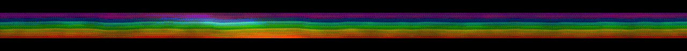
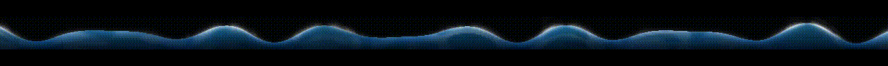
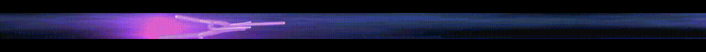
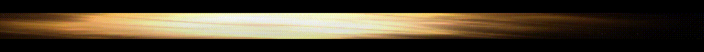
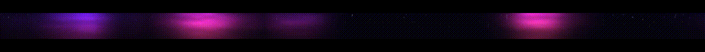
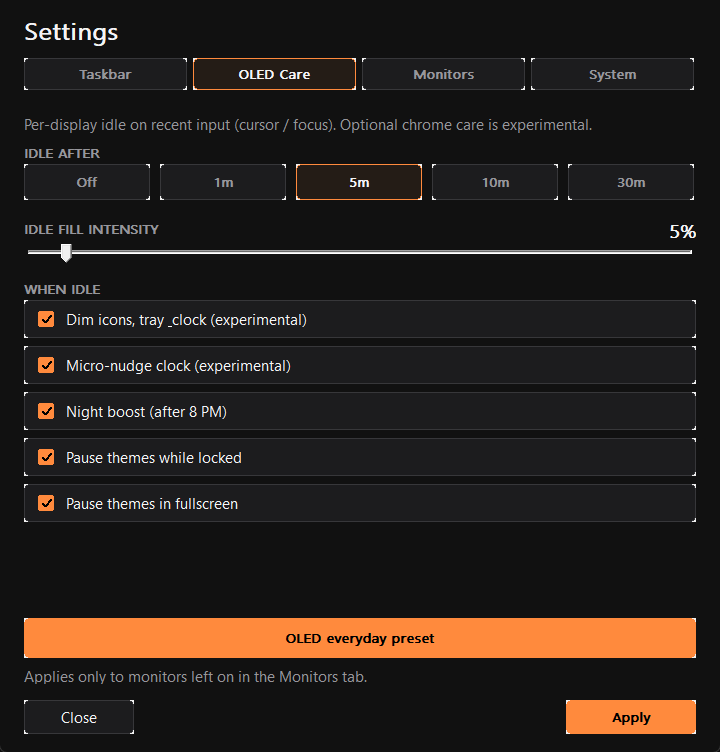
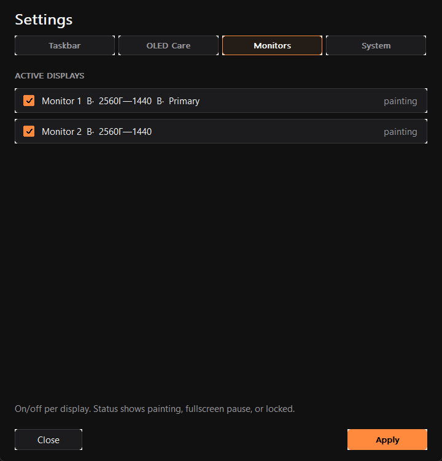
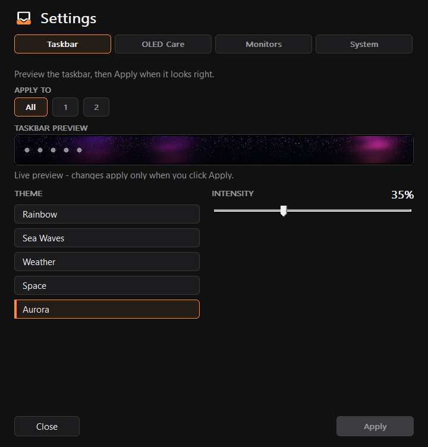
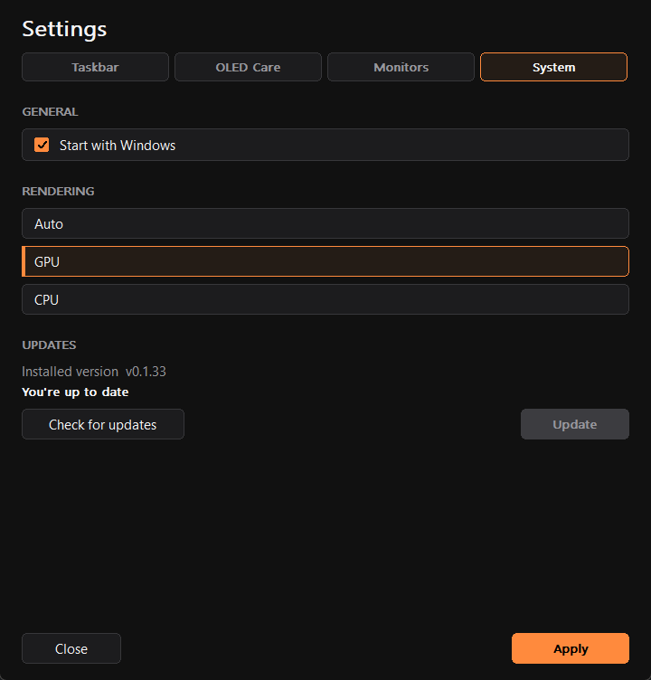

# Phostide

**OLED care for the real Windows 11 taskbar.**

Phostide keeps the bar usable: moving fill while you work, hybrid idle Care when you step away, per-monitor control — painted into Explorer’s own `BackgroundFill`. Not a floating overlay, not auto-hide. Quit, and the normal bar comes back.

**[Download](https://phostide.doticca.com)** · [GitHub Releases](https://github.com/teamdoticca/Phostide/releases) · [Docs](https://phostide.doticca.com/docs) · [FAQ](https://phostide.doticca.com/docs/faq)

Agent briefs: [llms.txt](https://phostide.doticca.com/llms.txt) · [llms-full.txt](https://phostide.doticca.com/llms-full.txt)

<p align="center">
  
</p>

## Themes

Five built-in looks. Switch from the tray. There is **no theme editor** and no custom theme import in the shipped app.

| | |
| --- | --- |
| **Rainbow** — soft color bands drifting across the bar |  |
| **Sea Waves** — side-on ocean silhouette with foam |  |
| **Weather** — night storm, purple flash, soft bolts |  |
| **Space** — mostly black with slow scattered stars |  |
| **Aurora** — magenta curtains over black |  |

Live captures (and longer loops) are on the [site](https://phostide.doticca.com/#themes). Space and Aurora are the darkest everyday OLED choices.

## Why this exists

Most OLED taskbar tools **hide** the bar. Phostide keeps it usable and moves the fill so a static strip is less likely to burn in — while looking like a theme, not a workaround.

- Real Explorer background fill (TAP helper + Composition surfaces)
- Multi-monitor: theme/intensity per display, on/off per display, live paint/pause status, shared Auto/GPU/CPU rendering
- Fullscreen pause (default on) freezes paint on the covered display so games keep the GPU
- Signed Setup.exe (per-user, no admin) and portable zip
- Local only — no account, no telemetry
- MIT open source
- Standalone — **no Windhawk** or separate taskbar overlay required

## What it is not

- Not a floating overlay window on top of the taskbar
- Not Windows auto-hide
- Not a Windhawk mod and not dependent on Windhawk
- Not an end-user theme editor
- Not a cloud service; does not need admin rights

## Settings

Tray icon › **Settings…** — four tabs with different jobs:

| Tab | Controls |
| --- | --- |
| **Taskbar** | Apply to **All** or monitor *N*: theme + intensity (preview, then **Apply**) |
| **OLED Care** | Hybrid idle fill dim (full AFK dims all bars; while you work, unused displays can dim alone); optional experimental chrome/clock care; night boost; pause when locked / in fullscreen (defaults on — fullscreen freezes the **covered display only**); **OLED everyday preset** (care-only — does not change theme/intensity) |
| **Monitors** | Per-display **on/off** (default all on). Off → stock Windows bar. Live status: painting / fullscreen / locked / off / paused |
| **System** | App-global only: Auto / GPU / CPU rendering, Start with Windows, updates |

Rendering mode is app-global. Care only paints monitors left on. Tray left-click toggles Enable (soft-pause; Exit restores stock brushes). Defaults on a fresh install (or after deleting the settings file): Aurora, 35% intensity, Auto rendering, OLED Care idle after 5 minutes, all monitors on. The first run opens a short Welcome in Settings to pick which displays are OLED. Settings file: `%APPDATA%\Phostide\settings.json`.

<p align="center">
  
</p>
<p align="center"><em>OLED Care — pause while locked / in fullscreen (defaults on)</em></p>

<p align="center">
  
</p>
<p align="center"><em>Monitors — on/off plus live painting / fullscreen / locked status</em></p>

<details>
<summary>Taskbar and System tabs</summary>
<p align="center">
  
  
</p>
</details>

### Multi-monitor OLED

On an OLED + LCD setup you can theme only the OLED: **Monitors** → uncheck the LCD; **Taskbar** → Apply to the OLED monitor → **Space** or **Aurora** at modest intensity → **Apply**. Optionally enable **OLED Care** or click **OLED everyday preset** (idle care only — your Taskbar theme stays put). Residual static chrome can still contribute to burn-in when Care is off.

## Requirements

- Windows 11 22H2 or later (XAML taskbar)
- x64

## Install

1. Get the latest **Setup.exe** from [phostide.doticca.com](https://phostide.doticca.com) or [Releases](https://github.com/teamdoticca/Phostide/releases).
2. Run it — tray icon appears. Right‑click › **Settings…** › **Taskbar** › pick a theme (All or one monitor) › **Apply**.
3. Optional: **Monitors** tab to leave a display stock; **System** tab for rendering / Start with Windows › Apply.

Portable zip: unzip anywhere and run `Phostide.exe`.

More detail: [Install & run](https://phostide.doticca.com/docs/install) · [FAQ](https://phostide.doticca.com/docs/faq) · [Compare approaches](https://phostide.doticca.com/docs/compare).

## Safety

Phostide restores the original taskbar brushes when it exits or crashes. It does not modify system files.

## Repo layout

```
src/     Native C++/WinRT host (Phostide.exe) + ExplorerTAP.dll
site/    Marketing / download mini-site (Next.js → Vercel)
docs/    Architecture overview + development runbook
```

## Development

Native build requires Visual Studio 2022 with C++ desktop + Windows SDK (10.0.22621+).

See [docs/architecture.md](docs/architecture.md) and the [development runbook](docs/development.md) for build, ThemeLab, and live TAP verify steps. Contribution guidelines: [CONTRIBUTING.md](CONTRIBUTING.md). Agent orientation: [AGENTS.md](AGENTS.md).

```powershell
# Native (from repo root) — see docs/development.md
# Site
cd site
npm install
npm run dev
```

## License

MIT — see [LICENSE](LICENSE). Made by [Doticca](https://doticca.com).
