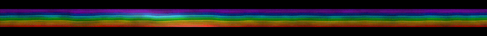
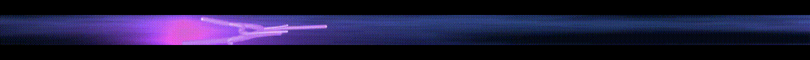
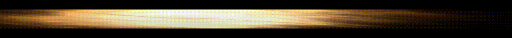
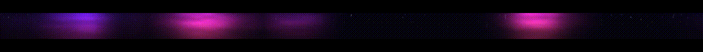

# Phostide

**OLED-safe animated themes on the real Windows 11 taskbar.**

Phostide paints motion into Explorer’s own taskbar `BackgroundFill` — not a floating overlay, not auto-hide. Icons stay on top. Quit, and the normal bar comes back.

**[Download](https://phostide.doticca.com)** · [GitHub Releases](https://github.com/teamdoticca/Phostide/releases) · [Docs](https://phostide.doticca.com/docs)

<p align="center">
  
</p>

## Themes

Five built-in looks. Switch from the tray.

| | |
| --- | --- |
| **Rainbow** — soft color bands drifting across the bar |  |
| **Sea Waves** — side-on ocean silhouette with foam |  |
| **Weather** — night storm, purple flash, soft bolts |  |
| **Space** — mostly black with slow scattered stars |  |
| **Aurora** — magenta curtains over black |  |

Live captures (and longer loops) are on the [site](https://phostide.doticca.com/#themes).

## Why this exists

Most OLED taskbar tools **hide** the bar. Phostide keeps it usable and moves the fill so a static strip is less likely to burn in — while looking like a theme, not a workaround.

- Real Explorer background fill (TAP helper + Composition surfaces)
- Signed Setup.exe (per-user, no admin) and portable zip
- Local only — no account, no telemetry
- MIT open source

## Requirements

- Windows 11 22H2 or later (XAML taskbar)
- x64

## Install

1. Get the latest **Setup.exe** from [phostide.doticca.com](https://phostide.doticca.com) or [Releases](https://github.com/teamdoticca/Phostide/releases).
2. Run it — tray icon appears. Right‑click › **Settings…** › pick a theme › **Apply**.
3. Optional: System tab › **Start with Windows** › Apply.

Portable zip: unzip anywhere and run `Phostide.exe`.

More detail: [Install & run](https://phostide.doticca.com/docs/install).

## Safety

Phostide restores the original taskbar brushes when it exits or crashes. It does not modify system files.

## Repo layout

```
src/     Native C++/WinRT host (Phostide.exe) + ExplorerTAP.dll
site/    Marketing / download mini-site (Next.js → Vercel)
docs/    Design notes
```

## Development

Native build requires Visual Studio 2022 with C++ desktop + Windows SDK (10.0.22621+).

```powershell
# Site
cd site
npm install
npm run dev
```

## License

MIT — see [LICENSE](LICENSE). Made by [Doticca](https://doticca.com).
